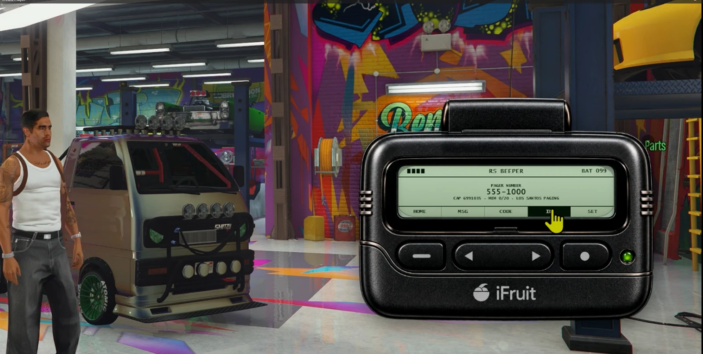
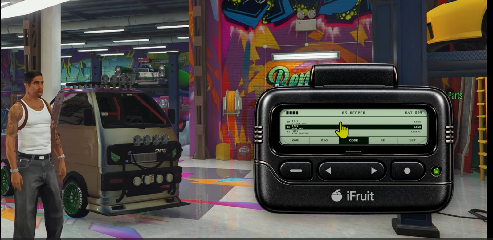
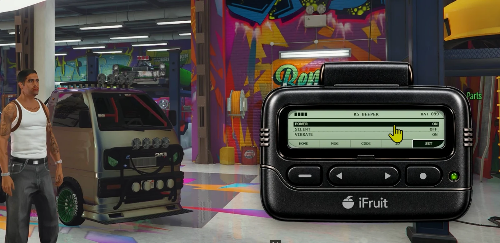

# RS 90s Beeper

<a href="https://reality-sucks-rp-webstore.tebex.io/package/7738385"></a>

Bring 90s pager culture to your server. Send numeric or text pages to players, jobs, departments and gangs, then let the callback become the RP. Persistent inboxes, pager identities, batteries, signal and integration exports keep the network connected.

[Download the original ZIP](https://github.com/RealitySucksRP/rs-90sbeeper/releases/latest/download/rs-90sbeeper.zip) | [Free on Tebex](https://reality-sucks-rp-webstore.tebex.io/package/7738385) | [Watch preview](https://youtu.be/GohA449FBdM?si=WSziL5N0f5f8qL8b) | [Website](https://realitysucksrp.github.io/) | [Discord](https://discord.gg/e9V3rPHySx) | [YouTube](https://www.youtube.com/@RealitySucksRP) | [All free scripts](https://reality-sucks-rp-webstore.tebex.io/category/free-scripts)

**Install folder:** `rs-90sbeeper`. Download the original ZIP to retain the package folder layout. Source, configuration, licenses and included assets are provided below.

<details>
<summary>More screenshots</summary>





</details>

## Package documentation

# RS 90s Beeper

`rs-90sbeeper` is a standalone RealitySucksRP pager network for 1990s RP. The visible device stays intentionally simple: it beeps, shows a short numeric/alphanumeric page, stores a small message history and gives the player a reason to find a payphone, landline, radio, meeting point or other RP system.

The power is behind the LCD. Any server-side phone, payphone, dispatch, radio, gang, drug, police, EMS, garage, job, inventory, business or custom resource can send pages through a generic API without becoming a hard dependency.

**This resource is not a voice radio and does not join pma-voice channels.**

## Identity

- Persistent pager number.
- Persistent capcode.
- Optional physical inventory item with metadata-backed device identity where the inventory supports it.
- Metadata-capable inventories assign a distinct persistent identity to each newly activated physical beeper item; existing item metadata is never rewritten during upgrade.
- 20-message default memory.
- Read/unread state.
- Locked messages survive automatic memory rollover.
- Oldest unlocked page is removed when memory fills.
- If all slots are locked, a new page is rejected with `memory_full` rather than silently destroying protected messages.
- Battery, power and signal state.
- Pages can queue while the device is off, dead or out of service and alert when service returns.

## Authentic device behavior

The pager does not make calls. A page may show:

```text
143
555-0198
USE PAYPHONE
```

or:

```text
911
555-0911
CALL NOW
```

or a normal late-90s alphanumeric page:

```text
CAR READY
LS CUSTOMS
555-0142
```

The external phone/payphone/radio/job resource completes the RP interaction.

## Pager code culture

A configurable starter codebook is included. Incoming pages do **not** auto-translate by default; `143` remains `143` unless the player enables CODE HINTS. The CODE menu can also be disabled entirely.

Examples include:

- `123` — I MISS YOU
- `143` — I LOVE YOU
- `424` — CALL ME BACK
- `831` — I LOVE YOU
- `823` — THINKING OF YOU
- `637` — ALWAYS AND FOREVER
- `911` — EMERGENCY / CALL NOW
- `07734` — HELLO when read upside down

Pager codes varied by region and social group. See `docs/PAGER-CODES.md` for the research note and starter list.

## Framework / inventory support

- Qbox priority
- QBCore
- ESX
- Standalone
- ox_inventory
- framework inventory fallback
- custom standalone inventory provider

Everything is detected internally. There is no external `rs_bridge` dependency.

## Installation

1. Put the folder in your resources directory as exactly `rs-90sbeeper`.
2. Add `ensure rs-90sbeeper`.
3. Leave `Config.RequirePagerItem = false` for a built-in device available to every character.
4. Set `Config.RequirePagerItem = true` and merge the item examples from `install/` for physical-device RP.

Default controls:

- `/beeper` — open/close
- No default key is registered. Server owners can enable a remappable key in `Config.Keybind` after choosing a non-conflicting binding. If an F-key is chosen, the close path uses the same asynchronous NUI focus protection as the RS radio twins.
- Pager LEFT / RIGHT rocker — previous / next top-level menu (HOME, MSG, CODE, ID, SET). In message detail it moves between the side-by-side LOCK / DELETE actions.
- Pager SELECT — enter / confirm the current item or action.
- Pager BACK — leave a detail view; from a menu it returns HOME; from HOME it closes the pager.
- Mouse wheel — scrolls only the MSG list or CODE list while the pointer is over the LCD. It never changes menu category.
- Keyboard — Left/Right changes category, Up/Down moves a vertical selection, Enter selects, Backspace goes back, Escape closes.
- `/rs90beeperdiag` — diagnostics
- `/rs90pagertest [code]` — self-page smoke test
- `/rechargebeeper` — replace/recharge the beeper battery. In pure Standalone mode this works without an inventory dependency; with an inventory integration, `Config.Battery.RequireRechargeItem = 'auto'` consumes a configured battery item.

## Generic server API

### Page a player

```lua
exports['rs-90sbeeper']:SendPageToPlayer(source, {
    sender = 'MARCUS',
    code = '143',
    message = '143',
    callback = '555-0198',
    instructions = 'USE PAYPHONE'
})
```

### Page a pager number

Works even while its owner is offline once the pager number exists in persistence:

```lua
exports['rs-90sbeeper']:SendPageToNumber('555-1430', {
    sender = 'UNKNOWN',
    code = '424',
    message = '424',
    callback = '555-0119'
})
```

When the owner is online, the server keeps a live pager-number -> player binding
through fast join retries plus periodic authoritative reconciliation. If a direct
number page arrives before that map is populated (for example, Qbox character
selection finished after the original join window), the beeper performs an
on-demand server-side owner recovery and alerts the matching live pager. The
player does not need to open the beeper once before number pages can beep.

### Police / EMS / jobs

```lua
exports['rs-90sbeeper']:SendPageToJob('police', {
    sender = 'DISPATCH',
    code = '911',
    message = '911',
    callback = 'HQ',
    priority = 'emergency'
}, true) -- duty only
```

```lua
exports['rs-90sbeeper']:SendPageToDepartment('ems', {
    sender = 'PILLBOX',
    message = 'TRAUMA CALL',
    callback = 'ER DESK'
})
```

### Gang / illegal activity

Framework gang route:

```lua
exports['rs-90sbeeper']:SendPageToGang('ballas', {
    sender = 'UNKNOWN',
    message = '187',
    code = '187'
})
```

Hidden custom network independent of framework jobs/gangs:

```lua
exports['rs-90sbeeper']:SetPlayerPagerGroup(source, 'cartel', true)

exports['rs-90sbeeper']:SendPageToGroup('cartel', {
    sender = 'SUPPLIER',
    message = '424',
    callback = '555-0177',
    instructions = 'USE PAYPHONE'
})
```

### Garage / business

```lua
exports['rs-90sbeeper']:SendPageToPlayer(source, {
    sender = 'GARAGE',
    message = 'CAR READY',
    callback = '555-0142'
})
```

### Broadcast

```lua
exports['rs-90sbeeper']:BroadcastPage({
    sender = 'CITY ALERT',
    message = 'SERVICE INTERRUPTION',
    priority = 'priority'
})
```

### Generic route API

```lua
exports['rs-90sbeeper']:SendPage({
    type = 'jobs',
    names = { 'police', 'sheriff' },
    dutyOnly = true
}, {
    sender = 'DISPATCH',
    message = 'CALL HQ',
    callback = '555-0911'
})
```

Supported route types:

```text
player
players
number
numbers
job / jobs
gang / gangs
group / groups
department
all / broadcast
```


## Citywide communication bus

Any **server-side** resource can also publish one device-neutral communication event. The beeper listens without depending on the sender, and ignores channel-only events because it is not a radio:

```lua
TriggerEvent('rs-comms:dispatch', {
    type = 'dispatch',
    priority = 'emergency',
    source = { callsign = '214', department = 'LSPD' },
    destination = {
        jobs = { 'police', 'sheriff' },
        dutyOnly = true,
        devices = { 'pager' }
    },
    message = { title = '10-13', body = 'VESPUCCI BLVD' },
    metadata = {
        code = '911',
        callback = '555-0911',
        instructions = 'USE PAYPHONE'
    },
    ttl = 300
})
```

The bus is intentionally registered with `AddEventHandler`, not `RegisterNetEvent`, so it is same-context server communication rather than a client-callable page-sending endpoint. TTL is preserved while a page waits behind no-service/jammer/power-off, and expired queued dispatches are discarded before they can beep stale.

## Communication capability discovery

Server resources that want to detect what this device supports can query:

```lua
local caps = exports['rs-90sbeeper']:GetCommunicationCapabilities()
-- caps.device == 'pager'
-- caps.voice == false
-- caps.serverAuthoritative == true
-- caps.offlineNumberDelivery == true
```

The common `rs-comms:dispatch` bus supports player, job, gang, hidden group, department and broadcast destinations (including `destination.dutyOnly` for job pages) and de-duplicates overlapping recipients before the pager is delivered. Callback numbers and short payphone instructions survive this bus as inert pager text; the pager still never places a call or joins voice.

## Phone and payphone integration

There is deliberately no hardcoded phone dependency. Hook the phone system's **server-side** page/payphone event into `SendPageToNumber` or `SendPageToPlayer`.

A typical 90s flow is:

```text
caller uses payphone
      ↓
enters pager number
      ↓
enters callback number or pager code
      ↓
phone resource server validates the call
      ↓
rs-90sbeeper SendPageToNumber(...)
      ↓
BEEP
      ↓
recipient finds a payphone and calls back
```

This also works with a modern phone resource: the phone can simply act as the sender while the beeper remains period-styled.

## Radio / dispatch integration

A radio or dispatch resource should create a **page**, not force this resource into voice channels.

```lua
exports['rs-90sbeeper']:SendPageToDepartment('police', {
    sender = 'LSPD DISPATCH',
    message = '10-13',
    callback = 'RADIO DISPATCH',
    priority = 'emergency'
})
```

The officer reads the pager, then uses the actual radio resource.

## Identity / lookup exports

```lua
local number = exports['rs-90sbeeper']:GetPagerNumber(source)
local identity = exports['rs-90sbeeper']:GetPagerIdentity(source)
local status = exports['rs-90sbeeper']:FindPagerByNumber('555-1430')
```

`FindPagerByNumber` intentionally returns identity/online status only, not private inbox contents.

## Runtime codebook API

```lua
exports['rs-90sbeeper']:RegisterPagerCode('1875', {
    meaning = 'MEET AT OLD WAREHOUSE',
    category = 'CREW',
    groups = { 'cartel' }
})
```

```lua
local decoded = exports['rs-90sbeeper']:DecodePagerCode(source, '143')
```

## Signal / jammer integration

The beeper does not ship a giant RF-control menu anymore. A jammer, mission, interior, tower or disaster resource can control pager service through small server APIs:

```lua
exports['rs-90sbeeper']:SetPlayerSignal(source, false, 0, 'NO SERVICE')
exports['rs-90sbeeper']:SetPlayerSignal(source, true, 4, 'SERVICE')
```

```lua
exports['rs-90sbeeper']:SetPlayerJammed(source, true, 'JAMMED')
exports['rs-90sbeeper']:SetPlayerJammed(source, false)
```

Queued pages alert when service returns.

## Internal event alternative

Server resources may also use the non-networked event:

```lua
TriggerEvent('rs-90sbeeper:server:sendPage',
    { type = 'number', number = '555-1430' },
    { sender = 'UNKNOWN', message = '424', callback = '555-0119' },
    function(result)
        print(json.encode(result))
    end
)
```

It is intentionally **not** registered as a client network event, so clients cannot directly forge arbitrary pages.

## Security model

- Client never chooses a job/gang recipient list.
- Direct client page-sending is not exposed.
- All message mutations operate only on the caller's bound pager.
- Server exports sanitize sender/body/code/callback lengths.
- External resource page rate limiting is included.
- NUI uses one RPC callback with request IDs and an 8-second timeout.
- Every NUI request receives success/error completion.
- Locked messages cannot be deleted until unlocked.
- Pager lookup does not expose stored messages.
- Live device identity is re-verified server-side after join and periodically,
  including character/inventory changes; stale source/device mappings are removed.
- Direct number-owner recovery reads authoritative framework/inventory identity;
  it does not accept a client-supplied claim that a pager number belongs to them.
- The pager still exposes only three literal client -> server net requests:
  open, centralized RPC and recharge. Page sending and `rs-comms:dispatch` remain
  same-context server integration surfaces.

## Diagnostics / integration visibility

Run `/rs90beeperdiag`. The short notification shows the pager number, live bind
status, communication protocol and how many external producers have actually
called the paging API since this resource started. Full detail is printed to F8:

```text
Framework: qbox
Inventory: ox_inventory
Persistence: json
Comm protocol: v2
Comm bus: rs-comms:dispatch
Live binding: YES | Device: PERSONAL:...
Binding checks: attempts=... reconcile=... recovery=... last=.../...
Pager: 555-1430
External producers seen this boot: rs-payphone(3), rs-dispatch(7)
```

`External producers seen this boot: NONE` means no external resource has actually
called the beeper export/event during the current resource session. It does not
pretend that merely having a phone/dispatch resource started proves it is wired.

## Persistence

`data/pagers.json` stores pager identity, number allocation, power, battery, profile and inbox state when the resource folder is writable. On read-only managed hosts, RS 90s Beeper automatically uses FiveM's built-in resource KVP store instead. **No SQL or oxmysql dependency is required.** Existing JSON is adopted automatically when the fallback first activates. If upgrading from v0.4.2 on a host that had already fallen back to the old oxmysql table, the resource can import that legacy row when oxmysql happens to be running; oxmysql remains optional and is not manifest-loaded.

The pager number follows the physical item on inventory systems where stable item metadata is supported. Frameworks without per-item metadata use a character/device fallback.

## Resource relationship

`rs-90sbeeper`, `rs-radio`, phones, payphones and dispatch can all run together. They do not need to share a voice controller and there is no hard dependency chain.

- `rs-radio` = real-time voice/channel operations.
- `rs-90sbeeper` = asynchronous paging/callback RP.
- `rs-tablet` = advanced operations/apps/investigation.

